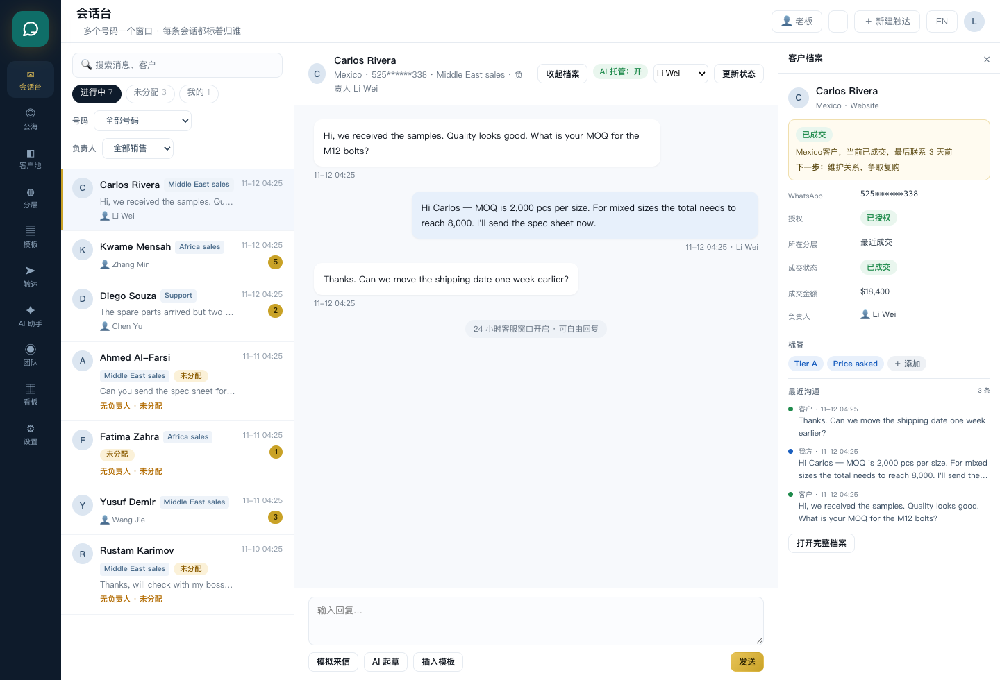
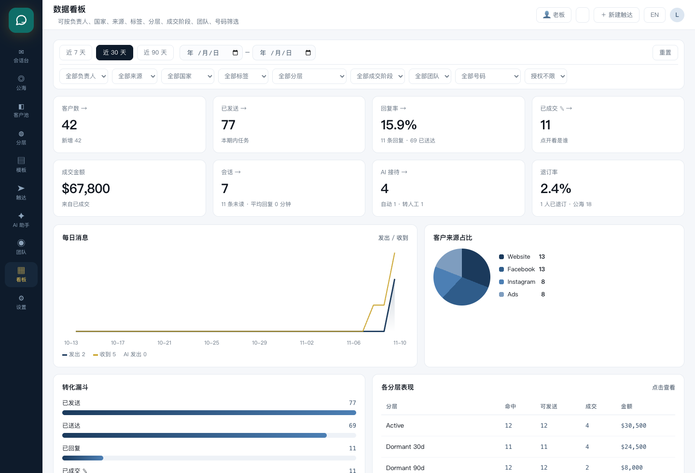
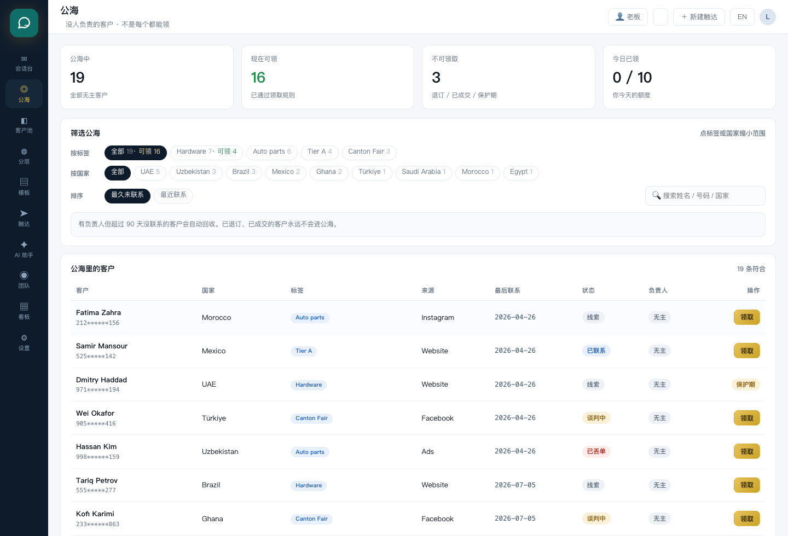
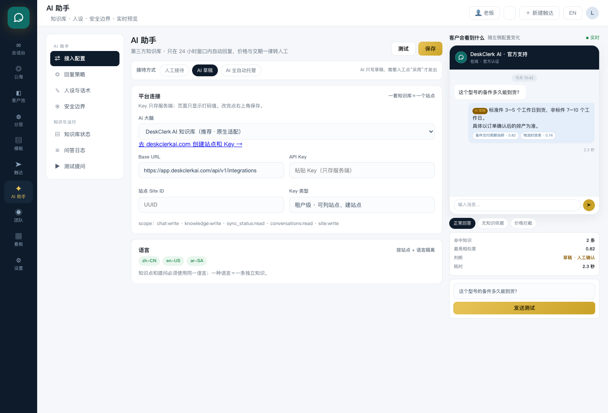

<p align="center">
  
</p>

<h1 align="center">DeskClerk AI Autopilot</h1>

<p align="center">
  <strong>Open-source WhatsApp CRM, shared inbox and AI customer-service desk.</strong><br>
  Self-host the workflow. Bring your own knowledge base. Use the official WhatsApp Cloud API.
</p>

<p align="center">
  <a href="https://github.com/deskclerkai/deskclerk-autopilot/actions/workflows/ci.yml"></a>
  <a href="LICENSE"></a>
  <a href="https://www.python.org/"></a>
  <a href="Dockerfile"></a>
  <a href="https://github.com/deskclerkai/deskclerk-autopilot/releases"></a>
  <a href="https://deskclerkai.com/?utm_source=github&utm_medium=readme&utm_campaign=ai_badge"></a>
  <a href="SECURITY.md"></a>
  <a href="CODE_OF_CONDUCT.md"></a>
  <a href="CONTRIBUTING.md"></a>
</p>

<p align="center">
  <a href="#quickstart">Quickstart</a> ·
  <a href="#problems-it-solves">Problems</a> ·
  <a href="#use-cases">Use cases</a> ·
  <a href="#features">Features</a> ·
  <a href="#screenshots">Screenshots</a> ·
  <a href="#connect-whatsapp-cloud-api">WhatsApp setup</a> ·
  <a href="#ai-reception">AI reception</a> ·
  <a href="#faq">FAQ</a> ·
  <a href="docs/">Documentation</a> ·
  <a href="README.zh-CN.md">中文说明</a>
</p>

> **Independent project.** This is not affiliated with, endorsed by, or sponsored by WhatsApp or Meta. WhatsApp is a trademark of Meta Platforms, Inc.

## What is DeskClerk AI Autopilot?

**DeskClerk AI Autopilot is a self-hosted, open-source WhatsApp CRM and shared inbox for teams.** It turns a company WhatsApp number into a managed customer-operation channel: every conversation has an owner, every customer has a profile, every campaign has a consent check, and AI can answer common questions with citations while handing the risky ones to a human.

It is built for businesses that use **WhatsApp Cloud API** or **WhatsApp coexistence**, not for unofficial QR-code gateways. The code is Python and vanilla JavaScript, stores data in SQLite, and runs as a single Docker container or a small server process.

Common searches this project answers:

- open-source WhatsApp CRM
- WhatsApp Cloud API CRM / shared inbox
- self-hosted WhatsApp customer service system
- WhatsApp AI chatbot with human handoff
- private-domain WhatsApp operations, retention and repeat purchase
- B2B and B2C WhatsApp CRM
- WhatsApp membership, renewal and after-sales service
- WhatsApp CRM for local service businesses
- multi-agent WhatsApp inbox
- WhatsApp contact ownership and public pool

## Screenshots

| Shared inbox with customer profile | Analytics with 12 boards |
|---|---|
|  |  |

| Public pool with claim rules | AI reception configuration |
|---|---|
|  |  |

## Who it is for

- **B2B teams** sharing company WhatsApp numbers for export, wholesale, distribution or long sales cycles.
- **B2C and DTC brands** using WhatsApp for pre-sales, orders, delivery questions and repeat purchase.
- **Local service businesses** coordinating delivery, installation, maintenance and warranty conversations.
- **Membership and retention teams** managing renewals, repeat purchase and high-value customer follow-up.
- Teams that need contact ownership, handover, a public pool and team-level permissions.
- Teams that want AI for repetitive questions but require a human handoff for price, delivery, legal or complaint topics.
- Operators who want their customer data in their own database, not locked inside a personal phone.

## Who it is not for

- A single person who only needs WhatsApp Business App.
- Teams looking for an unofficial WhatsApp gateway that bypasses Meta's API.
- Businesses that need a fully managed SaaS with zero server involvement.
- Multi-tenant resellers: this release is single-tenant by design.

## Problems it solves

Most teams do not start by searching for a “CRM”. They start with a mess: customers in personal phones, leads going cold, several people answering the same number, and no idea which campaign produced a deal. This project is built around those problems.

| Problem | What it usually looks like | What this project does |
|---|---|---|
| Customer ownership | Customers live in a salesperson's personal WhatsApp; when they leave, the customers leave too | The company number and customer records stay in the company database; owner is a field, not a phone |
| Shared number chaos | Several agents use one number and cannot see who replied | Shared inbox with assignment, ownership and owner-only reply mode |
| Leads going cold | New leads are never assigned, or nobody notices a customer has gone quiet | Public pool, protection period, daily quota and lifecycle segments such as “no contact for 30 days” |
| Duplicate or missed replies | Two people answer the same customer, or nobody answers | Conversation owner, unread counts, filters and a contact side panel with recent messages |
| Unsafe mass messaging | The team exports a list and sends to everyone, including opted-out contacts | Opt-in checks, permanent opt-out, approved templates and the 24-hour service window |
| No visibility | The owner sees activity but not conversion, response time or per-agent load | Twelve analytics boards by owner, team, number, country, tag, segment, stage and campaign |
| AI that cannot be trusted | A chatbot invents prices, promises delivery dates or answers without evidence | Knowledge-grounded answers with citations, confidence scores, hard topic blocks and human handoff |
| Staff turnover | Handover means screenshots and a new phone | Customer ownership transfer, conversation history and audit log stay in one place |
| Multilingual customers | The team cannot staff every language at all hours | Per-language AI personas and locale-specific knowledge, with human fallback |

## Use cases

“Private domain” means the customer relationship belongs to you: the contact list, the conversation history and the follow-up are yours, not rented from an ad platform or locked inside an employee's phone. The same workflow fits B2B, B2C, local services, membership retention and after-sales, but the operating motion is different.

| Scenario | Typical flow | What the system handles |
|---|---|---|
| **B2B export and wholesale** | Trade show or website lead → qualification → quotation → sample → repeat order | Country/tag segments, owner assignment, follow-up segments, public pool, deal stages |
| **B2C, DTC and independent stores** | Ad or website click → WhatsApp question → product recommendation → order → repeat purchase | Source tracking, fast replies, AI FAQ, handoff for price and delivery questions |
| **Private-domain selling and repeat purchase** | First order → tag and segment → service follow-up → reactivation → second order | Customer ownership, lifecycle segments, opt-in campaigns, after-sales conversations |
| **Membership and retention** | Member joins → tier/tag → renewal or repurchase reminder → support → referral | Tags, stages, segments, owner assignment, AI support, campaign eligibility |
| **Localized services** | Local inquiry → site/visit coordination → delivery or installation → maintenance | Country/city tags, local-language AI, conversation ownership, warranty follow-up |
| **After-sales and warranty** | Customer reports a problem → troubleshooting → replacement or repair | Support number, AI knowledge base, complaint escalation, conversation ownership |
| **Trade shows and field sales** | QR code or business card → many new contacts in a few days → follow-up over weeks | Bulk import, tag by event, claim quotas, protection period, reminder segments |
| **Education and training** | Inquiry → trial class → enrollment → renewal | Stage pipeline, counselor ownership, segment-based follow-up, multilingual AI |
| **Multi-brand or multi-number teams** | Several countries or product lines, each with its own number and team | Number → reception team → person permissions, per-number analytics |
| **Agencies and managed deployments** | One deployment per client, operated by an agency | Single-tenant isolation, branding policy, backup and audit trail |

### B2B export and wholesale teams

A typical export team collects leads from trade shows, referrals and a website, then follows up for weeks or months. The hard part is not the first message; it is remembering who owns each lead, which country and product they asked about, and when to follow up again. The system keeps that context in the contact record, assigns an owner, and builds segments such as “UAE leads, no contact for 30 days”.

### B2C, DTC and independent stores

A shopper messages the brand on WhatsApp before buying. Speed matters, but price, stock and delivery answers must be accurate. AI can answer repeated questions from the knowledge base and hand price or delivery commitments to a human. The source field shows whether the conversation started from the website, Instagram, Facebook or ads.

### Private-domain selling, repeat purchase and after-sales

This is the core private-domain loop:

```text
Acquire → first order → tag and segment → service follow-up
        → reactivation campaign → repeat order → after-sales → referral
```

The system supports the loop with:

- **Ownership**: every customer has an owner, so a repeat buyer does not disappear when a salesperson leaves.
- **Lifecycle segments**: Active, 30/90/180-day dormant, plus custom rules such as “bought product A, no contact for 60 days”.
- **Consent-aware campaigns**: the repeat-purchase message only goes to opted-in, non-opted-out customers.
- **After-sales continuity**: the same conversation history is available when the customer comes back with a problem.
- **AI for repetitive service**: order status, usage questions and spare-part questions can be answered from the knowledge base; complaints go to a human.

### Membership and retention

Membership does not have to mean a points wallet. In this system, membership-style retention is built from **tags, deal stages, segments and ownership**:

- tag members by tier, product, language or renewal month;
- segment members who are due for renewal or have gone quiet;
- assign a named owner to high-value members;
- send opt-in renewal reminders through an approved template;
- let AI handle routine member questions and hand exceptions to the owner.

There is no built-in points ledger or stored-value wallet. If you need one, integrate it through your own system rather than expecting this repository to be an e-commerce platform.

### Localized services

Local service businesses use WhatsApp for inquiries, delivery coordination, installation, maintenance and warranty. The system handles the conversation layer:

- country/city and service-type tags;
- local-language AI personas and knowledge;
- a named owner for each customer;
- follow-up segments for installation, maintenance and warranty dates;
- conversation history when the customer returns months later.

It does not include field-service dispatch, route planning or a technician mobile app. Those belong to a separate operations system.

### After-sales and warranty support

Support conversations are repetitive but sensitive. The AI can handle troubleshooting steps and spare-part questions with citations, while complaints, refunds and legal topics are escalated with the full conversation context. A separate support number can be granted only to the after-sales team.

## Features

### WhatsApp shared inbox

One inbox for every company number. Filter by number, owner and status. Assign a conversation, see the customer profile and recent messages beside the chat, and reply inside the 24-hour service window. Strict mode allows only the conversation owner to send.

### Contacts, ownership and public pool

Customers belong to the company, not to a personal phone. The `owner` field decides who follows a customer. Unassigned customers sit in the **public pool**; only people who pass the claim rules can take one:

- not opted out;
- not an already-won customer;
- outside the protection period;
- inside the agent's tag scope;
- within the daily claim quota.

### Segments and campaigns

Built-in lifecycle segments plus custom rules based on tags, country, source, deal stage, consent, ownership and last contact. Campaigns only include opted-in, non-opted-out contacts and require an approved template.

### AI reception with human handoff

Three modes, switchable per workspace and per conversation:

| Mode | Behavior |
|---|---|
| Manual | AI stays out of the conversation |
| AI draft | AI writes a draft; a human accepts it before sending |
| AI autopilot | Confident, sourced answers send automatically; everything else is handed off |

Price, discount, delivery-promise, contract, legal and complaint topics are blocked at the entry point. Answers include knowledge-base sources, a similarity score and a latency record.

### Roles and permissions

Owner, manager and agent roles; team-scoped data; field-level deal value; optional read-only seats; owner-only replies; company-level conversation visibility. Authorization is enforced in the backend, not by hiding buttons.

### Numbers and coexistence

Multiple business numbers, WABA sync, quality and limits, and team-level access. A documented coexistence path supports businesses that need the WhatsApp Business App on a phone and the API at the same time.

### Analytics

Nine business filters and twelve boards: funnel, source mix, segments, country, tag, owner, team, number, stage, campaign performance and AI reception quality. See [docs/数据看板与指标口径.md](docs/数据看板与指标口径.md).

## Official WhatsApp API only

This project does **not** use Baileys, WPPConnect, Evolution API, WAHA or any other unofficial WhatsApp gateway. Sending and receiving go through **WhatsApp Cloud API**; coexistence messages arrive through the official webhook.

That choice is deliberate:

- unofficial gateways violate WhatsApp's terms and put the business number at risk;
- the official API gives stable webhooks, template management and delivery semantics;
- the trade-off is real: templates need approval, marketing needs opt-in, and the 24-hour service window applies.

Read the official documentation: [WhatsApp Cloud API](https://developers.facebook.com/docs/whatsapp/cloud-api).

## Architecture

```text
Browser (vanilla JS SPA)
        │  JSON + JWT
        ▼
FastAPI  ──►  SQLite (WAL)
        │
        ├──► WhatsApp Cloud API webhook / send
        └──► Knowledge base API (DeskClerk by default)
```

| Layer | Choice | Why |
|---|---|---|
| Backend | FastAPI + Uvicorn | Small surface, typed request handling, easy to audit |
| Database | SQLite (WAL) | One-file deployment for a single team; simple backups |
| Frontend | Vanilla JS/CSS | No build step, no CDN, no third-party UI framework |
| Auth | PBKDF2 + JWT | No external identity provider required |
| AI | Provider-agnostic contract | DeskClerk first-class; other knowledge bases can be adapted |

## Quickstart

Requirements: Python 3.9+ and `git`.

```bash
git clone https://github.com/deskclerkai/deskclerk-autopilot.git
cd deskclerk-autopilot

python3 -m venv .venv
source .venv/bin/activate
pip install -r requirements.txt

export APP_SECRET="$(python3 -c 'import secrets;print(secrets.token_urlsafe(48))')"
./run.sh
```

Open `http://127.0.0.1:8000`.

The first launch seeds a demo workspace so every page is usable:

```text
owner@demo.com    / demo1234
manager@demo.com  / demo1234
agent@demo.com    / demo1234
```

**Never use the demo seed in production.** Set `DEMO_SEED=0` and create the first owner with `scripts/create_admin.py`.

## Docker

```bash
cp .env.example .env
# edit .env: set APP_SECRET and APP_ENV=production
docker compose up -d --build

docker compose exec app python /app/scripts/create_admin.py you@company.com 'a-long-password' 'Your Name'
```

The SQLite database lives in `./data` on the host. Back it up before upgrades. The container refuses to start in production without `APP_SECRET`.

## Connect WhatsApp Cloud API

1. Create a Meta app with the WhatsApp product and a business number.
2. In **Settings → Numbers**, add the WABA ID and Phone Number ID, or sync the whole WABA from Meta.
3. In **Settings → Integrations**, copy the webhook URL and fill in the verify token and app secret.
4. In Meta, set the callback URL to `https://your-host/webhook/whatsapp`, verify it, and subscribe to `messages`.
5. Send a test message from a real phone; it should appear in the inbox within a few seconds.

Inbound messages are de-duplicated by `wa_message_id`. Webhook signatures are verified when an app secret is configured. Outbound sending stays disabled until credentials exist, so a fresh install cannot accidentally message anyone.

Detailed guide: [docs/WhatsApp-账号体系与接入.md](docs/WhatsApp-账号体系与接入.md) and [docs/共存接入方案.md](docs/共存接入方案.md).

## AI reception

> **Recommended AI brain:** [DeskClerk AI Knowledge Base](https://deskclerkai.com/?utm_source=github&utm_medium=readme&utm_campaign=ai_section) — first-class integration out of the box. Any other knowledge base can be adapted behind the same contract.

This is not a generic chatbot wrapper that forwards every message to a model. The AI is wired into the WhatsApp workflow: it reads the incoming message, retrieves from a knowledge base, decides whether it is safe to answer, writes either a draft or a reply, and escalates to a human when the evidence is weak or the topic is sensitive.

### WhatsApp AI chatbot grounded in your knowledge base

| Capability | What it does | Why it matters |
|---|---|---|
| Grounded answers with citations | Each answer can carry the knowledge items and similarity scores used to produce it | Agents can see *why* the AI answered, not just *what* it said |
| Confidence threshold | Answers below the configured score are treated as low-confidence | Weak answers become handoffs instead of guesses |
| Three reception modes | Manual, AI draft and AI autopilot, switchable per workspace | Start safe, then automate only what proves reliable |
| Hard topic blocking | Price, discount, delivery promises, contracts, legal and complaints are stopped before the model is called | Prevents the most expensive AI mistakes |
| Per-conversation AI switch | Turn AI off for one customer without changing the workspace | Handles VIPs, negotiations and sensitive threads |
| Human handoff with context | The conversation, the AI draft, the sources and the reason for escalation stay together | The human does not restart the conversation from zero |
| Per-language personas | Separate persona, tone, company introduction and boundaries for each locale | One team can serve Arabic, English and Chinese customers |
| AI customer insights | Auto tags, a short summary, next-action suggestion and risk flags on the contact card | Turns conversation content into a usable sales cue |
| AI observability | Logs for question, answer, sources, score, decision and latency; auto/draft/handoff rates on the dashboard | You can measure quality instead of trusting a demo |
| Provider-agnostic contract | DeskClerk first-class, other knowledge bases adaptable behind the same response shape | Avoids lock-in at the workflow layer |

### How one AI turn works

```text
Customer message
      │
      ▼
Safety check ──► blocked topic? ──► human handoff
      │
      ▼
Knowledge-base retrieval
      │
      ├── no source / low score ──► human handoff
      │
      └── grounded answer
              │
              ├── manual mode: no AI action
              ├── draft mode: draft waits for a human
              └── autopilot mode: send automatically
                        │
                        ▼
                 log sources, score, decision, latency
```

### Human handoff instead of blind automation

The AI is designed to stop at the right moment:

- customer asks for a price, discount or quote;
- customer asks for a delivery commitment;
- the topic is a contract, legal issue, claim or complaint;
- the knowledge base has no matching source;
- the best similarity score is below the threshold;
- the customer explicitly asks for a human.

In those cases the system records the escalation reason, keeps the retrieved sources and hands the conversation to the owner. The AI does not send an empty answer or invent a policy.

### Set it up

1. Create a site and an integration key in DeskClerk AI.
2. Open the **AI assistant** page and fill in base URL, site ID and key.
3. Choose manual, AI draft or AI autopilot.
4. Run the built-in test question and inspect sources, score, decision and latency.

Keys are stored server-side and masked in the UI. They are never written to logs or shipped to the browser. `AICHAT_KEY` can supply the key by environment variable instead of the database.

The integration contract is documented in [docs/AI知识库接入.md](docs/AI知识库接入.md). Other knowledge bases can be adapted behind the same response shape.

## Configuration

| Variable | Default | Purpose |
|---|---|---|
| `APP_SECRET` | dev fallback in development | JWT signing key; required in production |
| `APP_ENV` | `dev` | Set `production` to enforce the secret check |
| `DB_PATH` | `data/app.db` | SQLite file |
| `DEMO_SEED` | `1` | `0` disables demo data and demo accounts |
| `ALLOWED_ORIGINS` | `*` | Comma-separated CORS origins; restrict in production |
| `AICHAT_KEY` | empty | Knowledge-base key supplied by environment |
| `WA_APP_SECRET` | empty | WhatsApp app secret fallback |
| `PORT` | `8000` | Port used by `run.sh` |

## Security and compliance

- PBKDF2 password hashing with per-user salts; 12-hour JWT expiry.
- Read-only seats are blocked from every write endpoint, not only hidden in the UI.
- Reply permission is enforced server-side: only the conversation owner can send.
- Webhook signature verification when an app secret is configured.
- Per-contact opt-in and permanent opt-out; opt-out contacts never enter a campaign.
- 24-hour service window and approved-template rules are reflected in the UI and the API.
- Audit log for login, assignment, claim, release, settings and AI changes.
- No analytics or telemetry is sent to the maintainers.

Report vulnerabilities privately: [SECURITY.md](SECURITY.md).

Hardening checklist for operators:

- `APP_ENV=production` and a long random `APP_SECRET`;
- `DEMO_SEED=0`;
- HTTPS behind Caddy or Nginx;
- restricted `ALLOWED_ORIGINS`;
- database and backups outside the web root;
- scheduled rotation of WhatsApp and knowledge-base credentials.

## Testing and quality

```bash
./scripts/run_all_tests.sh --quick   # API + smoke, under a minute
./scripts/run_all_tests.sh --full    # API, fuzz, edge/security/performance, UI, smoke
```

The suite starts its own servers and temporary databases. It covers:

- role, scope and read-only permission matrices;
- pool claim rules, protection period and quotas;
- AI configuration, mock and remote flows;
- 370 malformed requests with zero 500 responses;
- JWT tampering, `alg=none`, SQL injection and XSS payloads;
- database integrity and WAL backup;
- 2,000-contact performance;
- real browser flows across all pages and settings tabs.

GitHub Actions runs the full suite on every push and pull request. CodeQL and Dependabot are enabled for security and dependency hygiene.

## Project standards

| Area | Standard |
|---|---|
| Versioning | Semantic Versioning |
| Changelog | Keep a Changelog |
| License | Apache License 2.0 |
| Security | Private vulnerability disclosure |
| Community | Contributor Covenant 2.1 |
| Governance | Maintainer-led, documented in [GOVERNANCE.md](GOVERNANCE.md) |
| Contribution flow | [docs/CONTRIBUTING-WORKFLOW.md](docs/CONTRIBUTING-WORKFLOW.md) |
| Release process | [docs/RELEASING.md](docs/RELEASING.md) |
| Support | [SUPPORT.md](SUPPORT.md) |
| Roadmap | [ROADMAP.md](ROADMAP.md) |
| Citation | [CITATION.cff](CITATION.cff) |

## FAQ

### Is this really open source?

Yes. The code is licensed under Apache-2.0, an OSI-approved license. You can self-host, modify and redistribute it, including commercially.

### Does it use the official WhatsApp API?

Yes. It uses WhatsApp Cloud API for sending and receiving, plus the official coexistence webhook for businesses that keep the Business App on a phone. It does not use unofficial gateways.

### Can multiple agents use one WhatsApp number?

Yes. The number belongs to the company; staff log in with their own accounts. Conversations can be assigned, and strict mode allows only the owner to reply.

### Can I self-host it?

Yes. Run it with Python or Docker. A single team normally needs one process and one SQLite file. Put a reverse proxy in front for HTTPS.

### Does it work with the WhatsApp Business App?

The recommended path is Cloud API. A coexistence path is documented for businesses that need both the phone app and the API. Availability depends on Meta's current coexistence program.

### Where does customer data live?

In your own SQLite database. The maintainers do not receive it. If you enable an external knowledge base, the question and answer content is sent to that provider under its terms.

### How does AI handoff work?

Price, discount, delivery promises, contracts, legal topics, complaints and low-confidence answers are handed to a human. The AI draft mode never sends without a human accepting the draft.

### Is there a hosted version?

The project is self-hosted. DeskClerk AI provides a knowledge-base service for the AI brain; the operations desk remains yours to deploy.

## Roadmap

See [ROADMAP.md](ROADMAP.md). Near-term work includes password change, Postgres support, Docker Compose profiles, richer media handling and more AI provider adapters.

## Contributing

Issues and pull requests are welcome. Read [CONTRIBUTING.md](CONTRIBUTING.md) and the full [contribution workflow](docs/CONTRIBUTING-WORKFLOW.md) first. For security issues, follow [SECURITY.md](SECURITY.md) instead of opening a public issue.

The contribution path is:

```text
Issue → scope agreement → fork → branch → code + tests + docs
     → pull request → CI + CodeQL → review → merge → release
```

Contributors do not push directly to `main`. A maintainer merges after CI is green and the change is reviewed. Large features need an issue first so scope is agreed before code is written.

Good first contributions:

- documentation fixes and translations;
- provider adapters for other knowledge bases;
- tests for edge cases in pool and permission rules;
- deployment examples for Caddy, Nginx and systemd.

Release mechanics are documented in [docs/RELEASING.md](docs/RELEASING.md).

## License, trademark and attribution

**Code:** Apache License 2.0. See [LICENSE](LICENSE) and [NOTICE](NOTICE).

**Brand:** the DeskClerk name, DeskClerk AI name and logo are trademarks of the project owner. The code license does not grant permission to use them as the branding of a derivative product. See [TRADEMARK.md](TRADEMARK.md).

**Attribution request:** if you fork this project or publish a deployment, we ask you to keep the DeskClerk AI name, logo and a link back to this repository. This is a brand and attribution request, not an additional condition of the Apache-2.0 license. A license that *requires* every fork to display a logo or link would no longer be a standard open-source license, so we keep the code license clean and put brand rules in the trademark policy.

For a hosted or commercial distribution that uses the official DeskClerk branding, a separate brand license is available.

---

<p align="center">
  <sub>Built for teams that want customer ownership, official WhatsApp APIs and AI with a human handoff.</sub>
</p>
